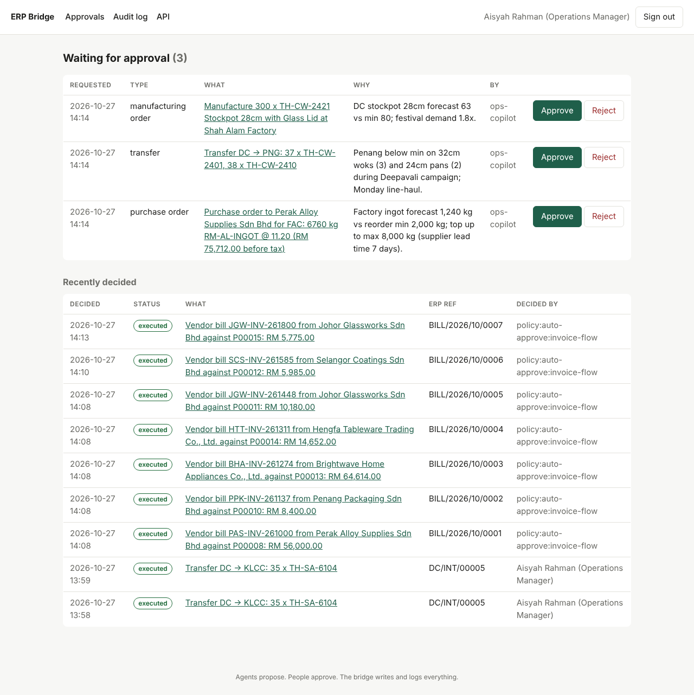
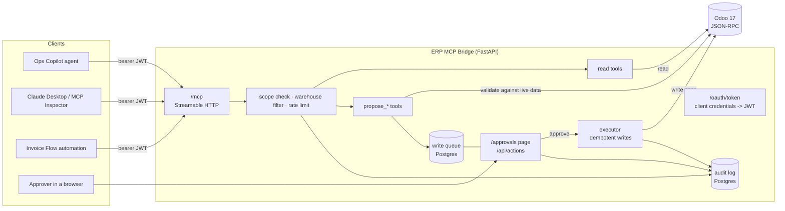

# ERP MCP Bridge

[](https://github.com/OWNER/erp-mcp-bridge/actions/workflows/ci.yml)
  

**The problem.** Manufacturers, distributors and retailers want AI agents to answer "what's in stock at KLCC?" and to draft the purchase order when it isn't — but nobody wants an agent with write access to their ERP. This repo puts an MCP server in front of Odoo that lets any agent read live data and *propose* changes, while a person approves every write and the bridge logs every call.

> Part of a three-repo showcase built around **Tembusu Housewares Sdn Bhd**, a fictional Malaysian company that manufactures cookware (factory in Shah Alam), distributes it (DC in Port Klang) and sells it (three stores, online, wholesale). See also [ops-copilot-agent](../ops-copilot-agent) and [invoice-flow](../invoice-flow).



## Architecture



Agents never hold ERP credentials and no tool writes to Odoo. A `propose_*` tool validates the request against live data (does the supplier exist, does the source warehouse have the stock, is the product actually manufactured) and stores a **pending action**. A person approves it on the approval page or through the JSON API; only then does the executor write to Odoo. Every tool call, decision and write lands in the audit log.

## What's inside

| Read tools | Scope | Write tools (propose only) | Scope |
|---|---|---|---|
| `get_stock_by_warehouse` | stock:read | `propose_purchase_order` | purchase:propose |
| `get_reorder_suggestions` | stock:read | `propose_stock_transfer` | transfer:propose |
| `list_transfers` · `list_warehouses` · `search_products` | stock:read | `propose_manufacturing_order` | manufacturing:propose |
| `list_open_invoices` · `get_customer_balance` | finance:read | `propose_vendor_bill` | vendor_bill:propose |
| `get_sales_by_period` | sales:read | `get_action_status` · `list_my_actions` | (own actions only) |
| `list_purchase_orders` · `get_purchase_order` | purchasing:read | | |
| `list_manufacturing_orders` · `get_bill_of_materials` | manufacturing:read | | |

**Safeguards**

- **Per-client scopes and warehouse restrictions** in the OAuth token. The `store-klcc` client sees only KLCC stock and sales, and has no finance scope.
- **Reviewed write queue.** Proposals are idempotent per client and key; approval is a compare-and-set, so a double click cannot write twice; the requester cannot approve their own action; the executor tags every Odoo record with the action id and looks it up before creating, so a crash between "Odoo wrote it" and "we recorded it" doesn't duplicate on retry.
- **Policy approvals for service accounts.** `invoice-flow` may post vendor bills without a second human click, because its own AP review queue is the human control. The audit log records `policy:auto-approve:invoice-flow` as the approver.
- **Rate limits** per client (Redis, fixed window), separately for writes.
- **Strict tool inputs.** Unknown fields are rejected, and errors are written so a model can fix its call ("No supplier matches 'Acme'", "PJ has only 0 of TH-SA-6104 available").
- **SSRF guard.** Callback URLs for "tell me when it's decided" must match an allowlist.
- **Audit log**: one row per tool call, auth event, decision and write, with arguments (secrets redacted), outcome and latency. Also printed as JSON lines for log shippers.

## Run it

```bash
cp .env.example .env          # defaults work; set REGISTRY=mirror.gcr.io if Docker Hub rate-limits you
docker compose up -d          # Odoo + Postgres + Redis + bridge
docker compose logs -f seed   # first run: creates the Odoo DB (~2 min) and loads 4 months of history (~12 min)
```

| What | Where |
|---|---|
| Approval page | http://localhost:8000/approvals (`approver-ops` / `approver-ops-demo-secret`) |
| MCP endpoint | http://localhost:8000/mcp |
| API docs (OpenAPI contract for the Approval Console) | http://localhost:8000/docs |
| Odoo | http://localhost:8069 (`admin` / `admin`) |

**Try it with MCP Inspector**

```bash
TOKEN=$(curl -s -d grant_type=client_credentials -d client_id=claude-desktop \
  -d client_secret=claude-desktop-demo-secret http://localhost:8000/oauth/token | jq -r .access_token)
npx @modelcontextprotocol/inspector   # Streamable HTTP, URL http://localhost:8000/mcp, header Authorization: Bearer $TOKEN
```

**Claude Desktop** (stdio; the token decides the scopes):

```json
{
  "mcpServers": {
    "tembusu-erp": {
      "command": "docker",
      "args": ["compose", "-f", "/path/to/erp-mcp-bridge/compose.yaml", "exec", "-T", "-e", "STDIO_TOKEN=<token>", "erp-bridge", "erp-bridge", "stdio"]
    }
  }
}
```

Then ask: *"Which raw materials at the factory are below their reorder point? Draft a PO for the aluminium."* The PO shows up on the approval page; approve it and it appears in Odoo with the action id in its source document.

**Demo clients** (secrets are `<client-id>-demo-secret`; override with `BRIDGE_SECRET_<CLIENT_ID>`):

| Client | Who | Scopes |
|---|---|---|
| `ops-copilot` | the Ops Copilot agent | all reads; propose PO / transfer / MO |
| `invoice-flow` | the invoice automation | purchasing:read; vendor_bill:propose (auto-approved by policy) |
| `store-klcc` | KLCC store manager | stock + sales for **KLCC only**; propose transfers |
| `finance-analyst` | finance | stock, sales, finance reads |
| `claude-desktop` | a demo human user | all reads; propose PO / transfer / MO |
| `approver-ops`, `approver-finance` | people | `actions:decide` (approval page and API) |

## The seed data

`seed/seed_odoo.py` builds a coherent business, deterministically: 5 warehouses, 26 finished goods (18 made in-house with bills of materials, 8 imported), 10 raw materials, 8 suppliers with price lists and lead times, 12 customers across three channels, ~200 sales orders over 120 days (delivered, invoiced, mostly paid; two wholesale customers pay late), 17 purchase orders in every state (billed, received, partly received, open), inter-warehouse transfers and manufacturing orders. Deliberate shortages make the questions worth asking: air fryers at KLCC below minimum, aluminium ingot at the factory below its reorder point, Deepavali wok demand.

## Tests

```bash
pip install -e ".[dev]"
pytest -q                                          # 25 unit + HTTP tests, fake ERP, no Docker needed
ODOO_URL=http://localhost:8069 pytest -m integration   # against the seeded Odoo
```

The HTTP tests start a real server and go through OAuth, MCP over Streamable HTTP, the approval API and the approval page (including CSRF). The write-queue tests cover idempotent proposals, double approval, self-approval, business vs. transient Odoo errors, crash-after-write recovery and policy approvals.

## Design notes

- **Business-level tools, not `search_read`.** Tools speak SKU, warehouse code and PO number. A model never sees Odoo domains or ids, and the same tool surface can front SAP Business One or Dynamics by swapping `OdooGateway`.
- **The bridge is its own small OAuth server** (client credentials, HS256 JWT) so the demo runs offline. In production, point `JWTTokenVerifier` at your IdP's JWKS (Entra ID, Auth0, Keycloak) and keep scopes and warehouse claims in the token.
- **Why not let agents write with a "dry run" flag?** Because the approval has to be outside the agent's control. The queue lives in the bridge, and the approve endpoint requires a scope agents don't get.

## What I'd do next

- Real IdP integration (Entra ID) with per-user delegated tokens instead of shared demo clients.
- An integration spike verdict for a second ERP (SAP Business One Service Layer) behind the same tools.
- Approval routing by value, following the purchasing approval matrix (≤ RM 10k ops manager; ≤ RM 50k plus finance; above that the MD).
- OpenTelemetry traces from tool call to Odoo RPC.

---

Built by [Your Name], Backend Engineer at Devs Core — [devs-core.com](https://devs-core.com). MIT licence. All company, supplier and customer names are fictional.
